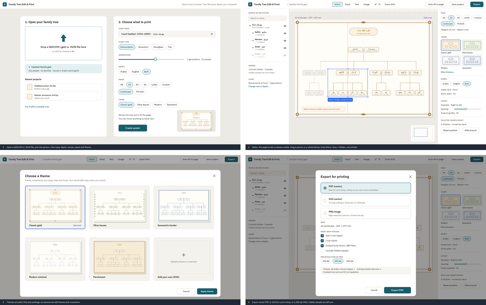

# Family Tree Edit & Print

A browser app for creating and editing a print-ready family tree poster. The
current version contains the setup shell and an Arabic rendering spike. The
spike is not the production editor: it compares draggable Konva and Fabric.js
canvases and exports embedded-font vector files from fictional Arabic, English,
and mixed-script names.



The product direction and open questions are in [SPEC.md](SPEC.md). Early
visual ideas are in [the mock-ups](docs/mockups/README.md).

## Project layout

- `src/main.ts` and `src/style.css`: browser entry point and starter screen.
- `src/spike.ts`, `src/pdf-export.ts`, and `src/spike-model.ts`: Arabic canvas
  comparison and exact-size vector PDF spike.
- `public/fonts/`: merged Noto Naskh Arabic font with its OFL license.
- `docs/architecture.md`: planned boundaries for future application features.
- `docs/mockups/`: early product and chart-style mock-ups.
- `research/`: product research.

## Local development

Use Node.js 22.18 or newer and npm.

```sh
npm ci
npm run dev
```

Open the local URL printed by Vite. Run the checks and build with:

```sh
npm run lint
npm run typecheck
npm test
npm run build
npm run preview
```

The production build is static and is written to `dist/`; it can be served by any static web host. Vite's development and preview servers are only local development tools, not application backends.

Choose **Preview editor workspace** to inspect the Arabic spike. Drag any name,
then export from either canvas. PDF output is A3 landscape (420 × 297 mm) with
the font embedded; Fabric.js also emits SVG with editable text and an embedded
font.

The app has no accounts, analytics, or server-side processing. Family data must stay on the user's computer. See [SPEC.md](SPEC.md) for the planned features and [the mockups](docs/mockups/README.md) for the intended screens.

## License

This project is released under the [MIT License](LICENSE).
Noto Naskh Arabic is distributed under the SIL Open Font License; see
`public/fonts/LICENSE-Noto-Naskh-Arabic.txt`.
